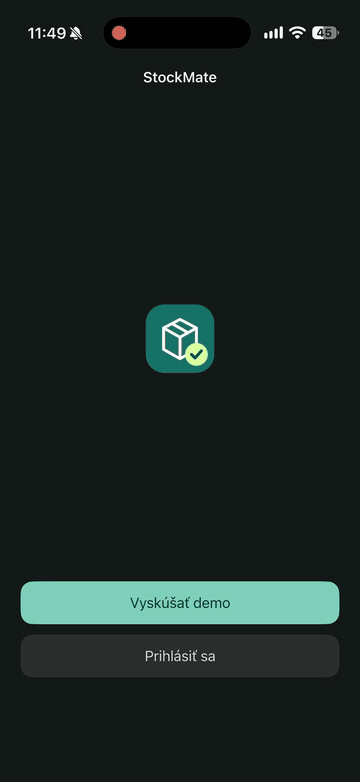
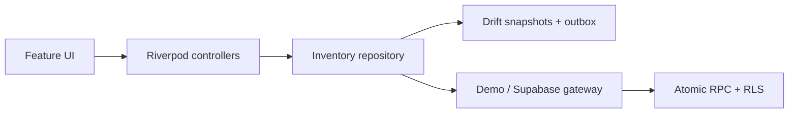

# StockMate

[](https://github.com/Kwispy232/stockmate/actions/workflows/demo.yml)

An offline inventory app built with Flutter. Scan a product, record its quantity, review differences, and submit the count safely after reconnecting.

**[Download demo builds](https://github.com/Kwispy232/stockmate/releases)** · **[Browse the implementation plan](docs/implementation-plan.md)**

<a href="docs/media/stockmate-demo.mp4"></a>

[Watch the demo video](docs/media/stockmate-demo.mp4)

## Run

Use **Flutter 3.47.9 / Dart 3.13.7**, pinned in `.flutter-version`, `.flutter-revision`, and `.fvmrc`.

```sh
flutter pub get --enforce-lockfile
flutter run
```

Choose **Explore the demo**. It needs no account, credentials, network, or backend setup. The bundled catalogue contains two stores with 30 products each. `scripts/flutterw run` also works with `FLUTTER_SDK`, FVM, or a sibling `flutter-sdk` checkout.

For the hosted workspace, register with an email and password. This nonproduction demo signs you in immediately without email confirmation or an SMTP service; email ownership is not verified. Every account gets the two sample stores; submissions are private to their author. The checked-in Supabase publishable key is public client configuration, protected by RLS. Privileged keys and database credentials are never app configuration.

## Try the whole workflow

1. Start an inventory and choose a store.
2. Scan a product or search by name, SKU, or barcode. Record a whole-number quantity; zero means explicitly counted, while a blank remains uncounted.
3. Mark genuinely missing products as zero, then review the differences.
4. In the local demo, switch **Demo connection** off in Settings and submit. The immutable count stays in the durable sending queue.
5. Restart the app, reconnect in Settings, and pull down on the inventory list to synchronize. The same submission ID is retried.

The local demo simulates transport failures. The authenticated workspace uses real HTTP requests and retains queued work after network failures. Synchronization runs while the inventory screen is active, on app resume, and on request; it is not an OS background service.

## Design

[Open the shared OpenPencil room](https://app.openpencil.dev/share/1rw1hpysg2m5nm7tsg3onc2oznc57tcz) · [Download the editable design](https://github.com/Kwispy232/stockmate/raw/refs/heads/main/docs/design/StockMate.fig)

The live room needs at least one participant with the document online. The downloadable `.fig` is always available from this repository. See [the design handoff](docs/design/README.md) for editing notes.

| Concern | Choice |
| --- | --- |
| State and dependencies | Riverpod Notifier / AsyncNotifier / StreamProvider |
| Organization | Feature-first with isolated domain rules |
| Routes | go_router, auth redirects, Cupertino/Material pages |
| Offline persistence | Drift / SQLite; transactional snapshot and outbox writes |
| Backend | Supabase Auth, Postgres, RLS, atomic submission RPC |
| Models | Freezed and generated JSON serialization |
| UI | Cupertino controls on iOS, Material 3 on Android, light/dark themes |
| Languages | Slovak and English ARB resources, plurals and locale-aware dates |
| Assets and camera | flutter_svg and mobile_scanner with manual barcode fallback |
| Delivery | GitHub Actions, fastlane, GitHub releases, Firebase App Distribution |



Feature-first groups related files; dependency boundaries keep domain rules independent of Flutter and persistence. A repository boundary supports the demo, hosted backend, and tests. There is no extra DI container or pass-through use-case layer.

Drafts are editable by their local owner. Queued and submitted counts are immutable. The server checks branch membership, canonical catalogue items, quantities, and completeness in one transaction. A stable UUID and payload fingerprint make retries idempotent and reject changed retries. Demo and authenticated users use separate SQLite files, and gateways reject an account switch.

The sample backend intentionally shares its two read-only catalogues among registered accounts. It demonstrates author/branch access boundaries; it is not a production organization-onboarding system. Only the latest 100 remote submissions are fetched, while local history is retained. Catalogue changes reject stale submissions rather than silently changing their stock snapshot. Collaborative editing and background execution are outside this demo's scope.

## Verify

```sh
dart run build_runner build
flutter gen-l10n
flutter analyze --fatal-infos
flutter test --coverage
flutter test integration_test/demo_flow_test.dart -d <simulator-or-device-id>
```

Domain and file-backed repository tests cover validation, explicit zero counts, disk-write failure, concurrent edits, restart recovery, offline queueing, and lost-response retries. Widget tests exercise both platform styles, password visibility without losing text or selection, pull-to-refresh on empty lists and after connection failures, validation, submission, Slovak/dark preferences, unknown IDs, and a narrow screen with large text. The native integration test exercises offline submission and reconnection using the real local database and plugins.

Backend checks are documented in [supabase/README.md](supabase/README.md). Physical camera scanning needs a device; manual lookup is available on simulators and when permission is denied.

After committing changes, `bash scripts/check.sh` additionally checks generated output, formatting, and the shared catalogue seed.

## Demo delivery

```sh
bundle install
bundle exec fastlane android demo
bundle exec fastlane ios demo
```

Android produces an ARM64 release APK with development signing. iOS produces an unsigned debug simulator archive containing both simulator architectures. Outputs and SHA-256/source manifests are under `build/artifacts/`.

PRs run quality and isolated backend checks. Pushes to `develop` also build downloadable Actions artifacts. A push/merge to `main` publishes a GitHub prerelease after the checks, native iOS integration test, and both builds succeed. Firebase distribution additionally builds a signed universal Android APK and an Ad Hoc iPhone IPA after verification. It runs on pushes when enabled or through the manual workflow option. See [Firebase setup and reviewer installation](docs/firebase-distribution.md). No TestFlight or Google Play setup is involved.

Generated Freezed/Drift/localization files and lockfiles are committed. `scripts/render_icon.swift` regenerates the original app icons on macOS; `scripts/generate_seed.py` keeps the local and hosted sample catalogues aligned.
